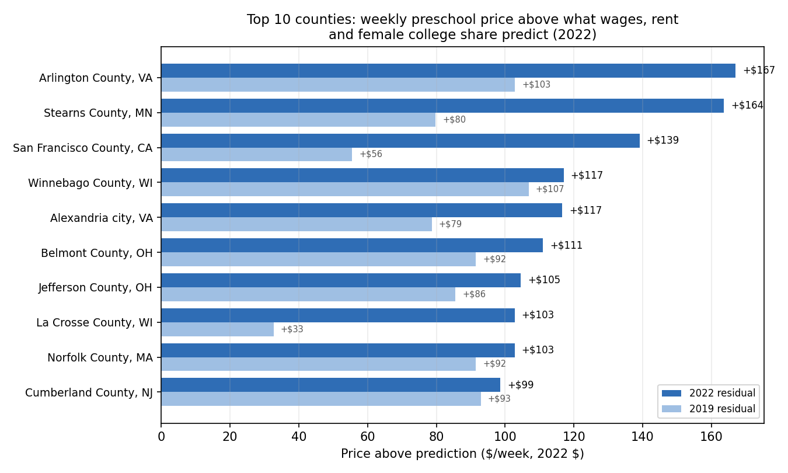
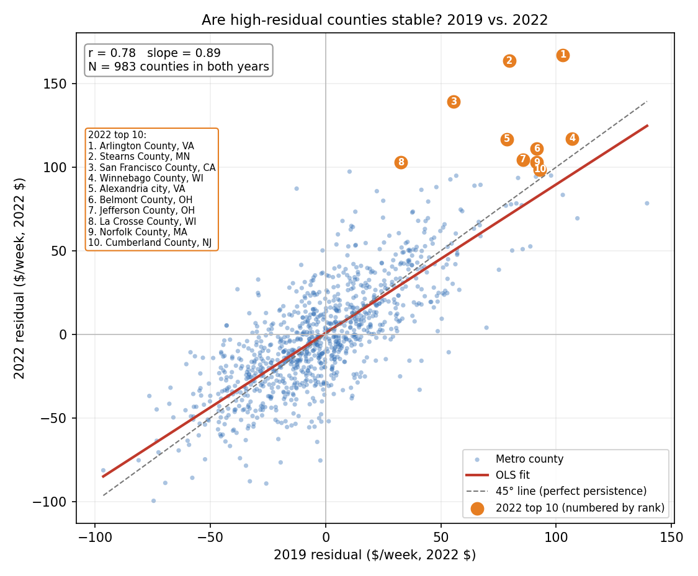
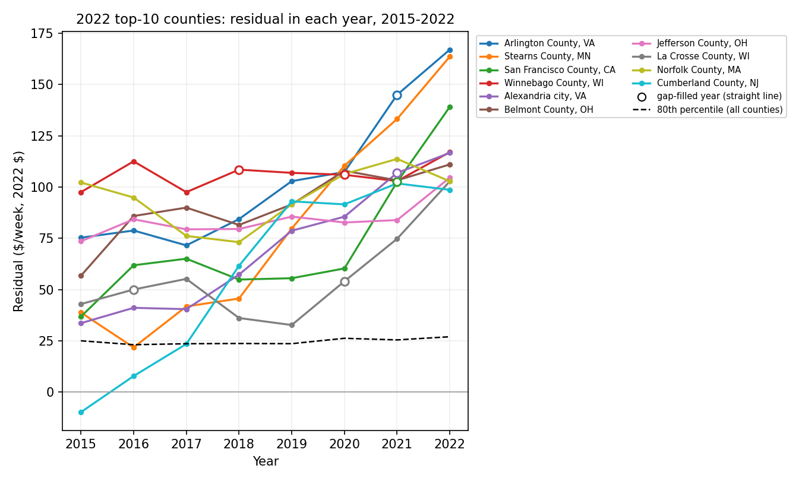

# MGT-403 Data Project — Final Project Analysis: Where Should We Open Our Next Daycare?

*Generated by `code/final_analysis.py` from `data/processed/panel_all_county_years.csv` (built by `code/pre_analysis.py`). Every number below is written by the script from its own output.*

## Recommendation: top 10 counties (2022)

1. **Arlington County, VA** (Washington-Arlington-Alexandria, DC-VA-MD-WV): +$167/week (+51% above predicted)
2. **Stearns County, MN** (St. Cloud, MN): +$164/week (+95% above predicted)
3. **San Francisco County, CA** (San Francisco-Oakland-Hayward, CA): +$139/week (+41% above predicted)
4. **Winnebago County, WI** (Oshkosh-Neenah, WI): +$117/week (+83% above predicted)
5. **Alexandria city, VA** (Washington-Arlington-Alexandria, DC-VA-MD-WV): +$117/week (+38% above predicted)
6. **Belmont County, OH** (Wheeling, WV-OH): +$111/week (+92% above predicted)
7. **Jefferson County, OH** (Weirton-Steubenville, WV-OH): +$105/week (+82% above predicted)
8. **La Crosse County, WI** (La Crosse-Onalaska, WI-MN): +$103/week (+66% above predicted)
9. **Norfolk County, MA** (Boston-Cambridge-Nashua, MA-NH): +$103/week (+32% above predicted)
10. **Cumberland County, NJ** (Vineland-Bridgeton, NJ): +$99/week (+55% above predicted)

---

## (b) Methodology

**Goal.** "Attractive" means a market where we can charge prices that are high **relative to costs**. We measure this as the gap between a county's actual price and the price predicted from its costs and its education level.

1. **Sample.** U.S. metro counties (OEWS area code beginning `00`), excluding Puerto Rico. Each year includes every county with a preschool price and all predictors, after short data gaps are filled with a straight line (see "Filling short data gaps" below). N = 1,005 in 2022. All dollar values are in constant 2022 dollars (CPI-U).
2. **Prediction model, estimated separately for each year 2015–2022:**
   - Outcome: median weekly center-based preschool price (NDCP `MCPRESCHOOL`).
   - Predictors: childcare-worker mean annual wage (OEWS 39-9011, $1,000s), median gross rent (ACS, $100s/month), and the share of women 25+ with a bachelor's degree (ACS, percentage points).
   - Wages and rent are the two main operating costs (labor and space). Female college share was added because it had the highest stand-alone R² of the demand variables screened in the pre-analysis, and it raises R² from 0.610 (wage + rent) to **0.657** in 2022.
   - Estimating each year separately means a county is always compared with other counties in the same year.
3. **Residual** = actual price − predicted price, in $/week. A positive residual means the county charges more than markets with the same wages, rent and education level. That premium is margin we could potentially capture.
4. **Ranking.** Counties are ranked by their 2022 residual and the top 10 are recommended. There is no one-county-per-metro limit; repeated metros are flagged below.

### Filling short data gaps (straight-line method)

Some county-years are missing a value only because a source skipped a year:

- **NDCP has no 2021 prices** for Virginia, California, North Carolina and a few other states.
- **BLS suppressed** the childcare-worker wage for some metros in some years. Examples: Oshkosh, WI in 2018 and 2020; La Crosse, WI in 2016 and 2020.

**Rule.** A missing value is filled by drawing a straight line between the nearest observed years before and after the gap, under four conditions:

- The gap is at most 2 consecutive years.
- There is an observed value on **both** sides. The endpoints 2015 and 2022 are never filled, so every 2022 price and residual used for the recommendations is observed.
- The county is in the metro sample in those years.
- The rule is applied to every county and variable, not just promising ones.

This is the same method NDCP itself uses for years between state price surveys. Its technical report describes imputing missing years by "the linear trend between years of usable data". Prices and wages are filled in nominal dollars and then converted to 2022 dollars with CPI-U.

| | Observed only | With gap fill |
|---|---:|---:|
| County-years in the analysis | 8,089 | 8,273 |
| 2019 counties | 1,061 | 1,063 |
| 2021 counties | 841 | 1,007 |
| 2022 counties | 1,005 | 1,005 |

- **Values filled:** preschool prices: 163, childcare-worker wages: 26.
- **County-years added:** 184, by year 2016: 2, 2017: 2, 2018: 1, 2019: 2, 2020: 11, 2021: 166. The most came from VA 80, NC 46, CA 38, WA 5, WI 5, IL 3.
- **Recommended counties with filled years:** Arlington County, VA (2021); San Francisco County, CA (2021); Winnebago County, WI (2018, 2020); Alexandria city, VA (2021); La Crosse County, WI (2016, 2020). Filled values are flagged (`imputed_any` and `imp_*` in `final_residuals_all_years.csv`) and drawn as hollow markers in the over-time chart.
- **Caveat:** filled years are estimates, not observations. They are used only to keep each county's track record continuous for the stability checks.

**Model estimates by year** (HC1 robust SEs in parentheses):

| Year | N (of which gap-filled) | Wage ($1,000s) | Rent ($100s) | College share (pts) | R² | Resid. SD ($/wk) |
|---:|---:|---:|---:|---:|---:|---:|
| 2015 | 994 (0) | 7.76 (0.70) | 3.10 (0.82) | 1.93 (0.18) | 0.619 | 34.4 |
| 2016 | 1,021 (2) | 7.73 (0.43) | 2.95 (0.62) | 1.90 (0.16) | 0.641 | 32.0 |
| 2017 | 1,059 (2) | 7.81 (0.40) | 3.14 (0.63) | 1.98 (0.16) | 0.662 | 33.4 |
| 2018 | 1,063 (1) | 7.18 (0.34) | 3.74 (0.55) | 1.84 (0.15) | 0.693 | 31.0 |
| 2019 | 1,063 (2) | 7.00 (0.30) | 3.48 (0.52) | 1.80 (0.15) | 0.700 | 30.6 |
| 2020 | 1,061 (11) | 6.17 (0.29) | 3.62 (0.55) | 1.74 (0.17) | 0.672 | 33.0 |
| 2021 | 1,007 (166) | 7.09 (0.33) | 2.11 (0.59) | 1.77 (0.16) | 0.674 | 33.9 |
| 2022 | 1,005 (0) | 7.23 (0.33) | 2.19 (0.61) | 1.62 (0.17) | 0.657 | 35.1 |

The wage coefficient (6.17–7.81), the college-share coefficient (1.62–1.98) and R² (0.619–0.700) are similar across years, so the yardstick is broadly consistent over time. The rent coefficient moves more (2.11–3.74), because rent and college share are highly correlated. *Files: `output/tables/final_models_by_year.csv` and `final_residuals_all_years.csv`.*

### Top 10 in detail

| Rank | County | Metro area (OEWS) | Population | Actual price ($/wk) | Predicted ($/wk) | Residual ($/wk) | Residual % | 2019 residual (percentile) | Years in top quintile | Gap-filled years | Rank, cost-only model |
|---:|---|---|---:|---:|---:|---:|---:|---:|---:|---|---:|
| 1 | Arlington County, VA † | Washington-Arlington-Alexandria, DC-VA-MD-WV | 235,845 | $496.30 | $329.28 | **+$167.02** | +51% | +103 (100th) | 8 of 8 | 2021 | 1 |
| 2 | Stearns County, MN | St. Cloud, MN | 158,622 | $336.67 | $173.03 | **+$163.64** | +95% | +80 (98th) | 7 of 8 | — | 2 |
| 3 | San Francisco County, CA | San Francisco-Oakland-Hayward, CA | 851,036 | $477.04 | $337.90 | **+$139.14** | +41% | +56 (96th) | 8 of 8 | 2021 | 4 |
| 4 | Winnebago County, WI ‡ | Oshkosh-Neenah, WI | 171,197 | $258.75 | $141.72 | **+$117.03** | +83% | +107 (100th) | 8 of 8 | 2018, 2020 | 5 |
| 5 | Alexandria city, VA † | Washington-Arlington-Alexandria, DC-VA-MD-WV | 157,594 | $424.29 | $307.66 | **+$116.63** | +38% | +79 (98th) | 8 of 8 | 2021 | 3 |
| 6 | Belmont County, OH ‡ | Wheeling, WV-OH | 66,554 | $232.00 | $120.98 | **+$111.02** | +92% | +92 (99th) | 8 of 8 | — | 12 |
| 7 | Jefferson County, OH ‡ | Weirton-Steubenville, WV-OH | 65,280 | $232.00 | $127.43 | **+$104.57** | +82% | +86 (99th) | 8 of 8 | — | 13 |
| 8 | La Crosse County, WI ‡ | La Crosse-Onalaska, WI-MN | 120,216 | $258.75 | $155.94 | **+$102.81** | +66% | +33 (87th) | 8 of 8 | 2016, 2020 | 8 |
| 9 | Norfolk County, MA | Boston-Cambridge-Nashua, MA-NH | 722,112 | $420.00 | $317.21 | **+$102.79** | +32% | +92 (99th) | 8 of 8 | — | 9 |
| 10 | Cumberland County, NJ | Vineland-Bridgeton, NJ | 153,588 | $276.77 | $178.14 | **+$98.63** | +55% | +93 (99th) | 5 of 8 | — | 33 |

- **Repeated metros (†):** Washington-Arlington-Alexandria, DC-VA-MD-WV (2 counties). The 10 picks cover 9 distinct metro markets.
- **Shared prices (‡):** 4 of the 10 report exactly the same NDCP price as other metro counties in their state (see "reliability" below).
- **Rank in the cost-only model:** the last column gives each county's rank when the residual is computed from wage + rent only.

**Next 5 alternates (ranks 11–15):**

| Rank | County | Metro area (OEWS) | Population | Actual price ($/wk) | Predicted ($/wk) | Residual ($/wk) | Residual % | 2019 residual (percentile) | Years in top quintile | Gap-filled years | Rank, cost-only model |
|---:|---|---|---:|---:|---:|---:|---:|---:|---:|---|---:|
| 11 | San Mateo County, CA | San Francisco-Oakland-Hayward, CA | 754,250 | $437.17 | $339.82 | **+$97.35** | +29% | +10 (66th) | 5 of 8 | 2021 | 41 |
| 12 | District of Columbia, DC | Washington-Arlington-Alexandria, DC-VA-MD-WV | 670,587 | $392.50 | $296.89 | **+$95.61** | +32% | n/a | 1 of 1 | — | 6 |
| 13 | Anoka County, MN ‡ | Minneapolis-St. Paul-Bloomington, MN-WI | 363,985 | $309.00 | $214.01 | **+$94.99** | +44% | +98 (100th) | 8 of 8 | — | 17 |
| 14 | Eau Claire County, WI ‡ | Eau Claire, WI | 105,697 | $258.75 | $163.87 | **+$94.88** | +58% | +57 (96th) | 8 of 8 | — | 11 |
| 15 | Olmsted County, MN ‡ | Rochester, MN | 162,307 | $309.00 | $214.70 | **+$94.30** | +44% | +91 (99th) | 8 of 8 | — | 7 |

### How reliable are these predictions?

- **Model fit.** In 2022 the model explains 66% of the price variation across counties. The residual SD is $35/week. Every top-10 residual is at least $99/week, or 2.8 SDs above zero.
- **Robustness to the model choice.** With the cost-only model (wage + rent), **7 of the 10** counties stay in the top 10:

| Rank (cost-only) | County | Metro area | Residual ($/wk) | Rank in main model |
|---:|---|---|---:|---:|
| 1 | Arlington County, VA | Washington-Arlington-Alexandria, DC-VA-MD-WV | +$199.85 | 1 |
| 2 | Stearns County, MN | St. Cloud, MN | +$169.48 | 2 |
| 3 | Alexandria city, VA | Washington-Arlington-Alexandria, DC-VA-MD-WV | +$142.31 | 5 |
| 4 | San Francisco County, CA | San Francisco-Oakland-Hayward, CA | +$141.72 | 3 |
| 5 | Winnebago County, WI | Oshkosh-Neenah, WI | +$126.00 | 4 |
| 6 | District of Columbia, DC | Washington-Arlington-Alexandria, DC-VA-MD-WV | +$120.36 | 12 |
| 7 | Olmsted County, MN | Rochester, MN | +$119.38 | 15 |
| 8 | La Crosse County, WI | La Crosse-Onalaska, WI-MN | +$118.84 | 8 |
| 9 | Norfolk County, MA | Boston-Cambridge-Nashua, MA-NH | +$115.46 | 9 |
| 10 | McLean County, IL | Bloomington, IL | +$111.04 | 26 |

  Counties that are top 10 in both models are the most robust picks. Those that rank lower in the cost-only model look attractive partly because they have fewer college-educated women than their price would suggest.
- **Stability over time.** Residuals persist strongly (next section), so a high 2022 residual is not just a one-year blip.
- **Data caveat: prices set at a regional level.** In 2022, 60% of metro counties report exactly the same NDCP price as at least one other metro county in their state. Some state market-rate surveys appear to publish prices by region or tier rather than county by county. For the ‡ counties, the residual partly reflects a regional price applied to a lower-cost county, so a local price check is needed before committing.

---

## (c) Market characteristics used to predict promising locations

| Characteristic | Source | Role in the model (2022) |
|---|---|---|
| Childcare-worker mean annual wage | BLS OEWS, SOC 39-9011, metro level | Labor cost: $7.23/week of price per $1,000 (p < 0.001) |
| Median gross rent | ACS 5-year | Space cost: $2.19/week per $100/month (p < 0.001) |
| Share of women 25+ with a bachelor's degree | ACS 5-year | Demand and affluence: $1.62/week per percentage point (p < 0.001) |
| **Residual (price − predicted)** | derived | **Ranking criterion:** price premium not explained by costs or education |

---

## (d) Is the price premium stable over time? 2019 vs. 2022

Residuals were computed the same way in every year. **983 counties** have a price in both 2019 (pre-Covid) and 2022.

- **Strong persistence.** The correlation between 2019 and 2022 residuals is **r = 0.78** (rank correlation 0.75). 79% of counties keep the same sign: above-prediction counties stay above, below stay below. With the cost-only model the correlation is 0.81.
- **Some regression to the mean.** Regressing the 2022 residual on the 2019 residual gives a slope of **0.89** (HC1 SE 0.03). A county that was $100 above prediction in 2019 is expected to be about $89 above in 2022. Part of any single year's premium fades, but most of it persists.
- **Quintile transitions.** Of counties in the top residual quintile in 2019, **69%** are still in the top quintile in 2022 (20% would be expected by chance), and 91% are in the top two quintiles. Only 1 of the 203 bottom-quintile counties (0.5%) jump to the top.

| 2019 quintile ↓ / 2022 → | 1 (lowest) | 2 | 3 | 4 | 5 (highest) | Counties |
|---|---:|---:|---:|---:|---:|---:|
| 1 (lowest) | 55% | 29% | 11% | 4% | 0% | 203 |
| 2 | 25% | 36% | 24% | 12% | 3% | 204 |
| 3 | 13% | 23% | 32% | 25% | 6% | 201 |
| 4 | 3% | 8% | 26% | 38% | 24% | 193 |
| 5 (highest) | 1% | 2% | 6% | 23% | 69% | 182 |

- **The 2019 top 10.** Of the 2019 top-10 counties, 10 have a 2022 price. 5 of them are still in the 2022 top 10, and 10 are still in the 2022 top quintile.
- **Our 2022 top 10 over time:**

  The counties that were in the top residual quintile in every year with data (gap-filled years included) are Arlington County, VA, San Francisco County, CA, Winnebago County, WI, Alexandria city, VA, Belmont County, OH, Jefferson County, OH, La Crosse County, WI, Norfolk County, MA. These are the most consistent picks. 
- **Longer horizon.** The correlation of each year's residual with 2022 is 2015: 0.50, 2016: 0.54, 2017: 0.60, 2018: 0.66, 2019: 0.78, 2020: 0.84, 2021: 0.95. It is weaker further back, as expected, but premiums are clearly persistent across the whole period. The 2021 figure is partly mechanical: 166 of the 2021 county-years are straight-line fills built partly from 2022 values.

---

## (e) What the predictions are missing

- **Competition and supply.** The number of existing centers, their capacity and waitlists, and whether a large chain is already present. A high price may reflect a shortage that new entrants (including competitors) will close.
- **Demand volume.** The model ranks price premiums, not market size. Counties with few young children or modest population growth may not fill a center.
- **Regulation and subsidies.** State staff-to-child ratios, licensing costs, and CCDF and state pre-K programs. Universal public pre-K can sharply cut demand for paid preschool.
- **Commercial real estate.** We use residential median gross rent as a proxy for space cost. Actual commercial lease rates, zoning, and site availability matter more for a center.
- **Labor availability.** OEWS wages are metro-wide averages. Hiring difficulty, turnover and benefits costs are not captured.
- **Price measurement.** NDCP prices are medians from state market-rate surveys, sometimes set at a regional level (see ‡ above), and are missing for some states and years. A local price survey is needed before committing.
- **Quality and mix.** Accreditation, hours, and the age mix (infant and toddler care is more labor-intensive) affect both what can be charged and costs.
- **Other demand drivers.** Household income, commuting patterns and employer-sponsored care.

---

## Data handling notes (for the appendix)

- **Input:** `data/processed/panel_all_county_years.csv`, built by `code/pre_analysis.py`. It contains all metro county-years before missing-data drops. Its data handling decisions are in `output/pre_analysis_writeup.md`. The script checks that its observed (non-filled) rows reproduce `analysis_dataset.csv` exactly.
- **Straight-line gap fill:** interior gaps of at most 2 years with observed values on both sides are filled by linear interpolation, in nominal dollars and then deflated. Endpoints are never filled. All filled values are flagged.
- **No minimum-years rule:** each year uses every county with a price and all predictors after the gap fill.
- **Separate regressions by year.** The model is re-estimated for each year 2015–2022. Residuals are therefore relative to the same year's cross-section, and all dollars are in 2022 dollars.
- **Quintiles and percentiles** are computed within each year's full sample.
- **Stability comparisons** use counties present in both years being compared.
- **Same-price check:** `same_price_n` counts how many metro counties in the same state and year report an identical nominal NDCP price.
- **Robust SEs:** HC1, from the same hand-coded OLS used in the pre-analysis.
