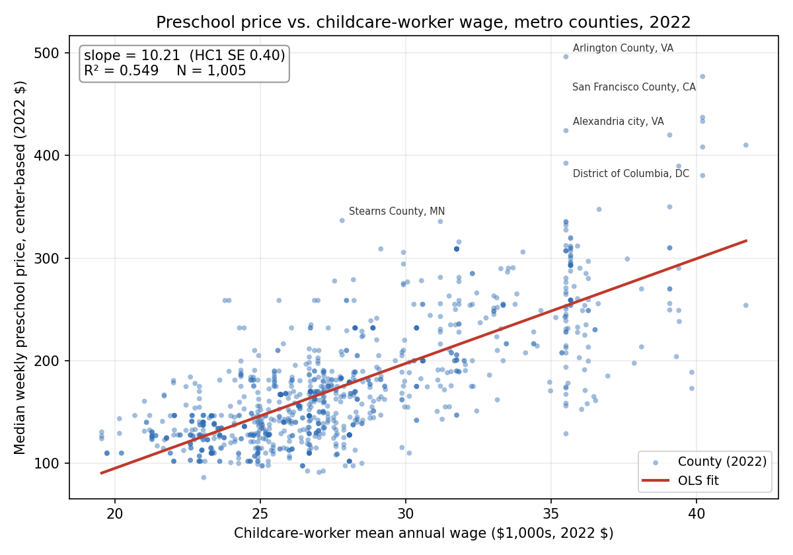
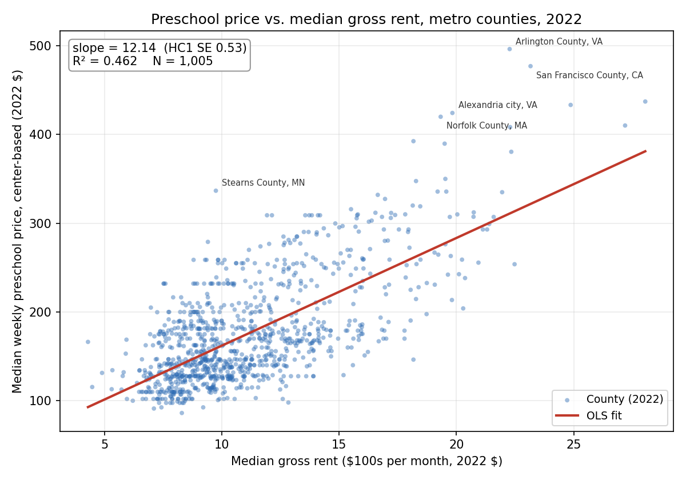
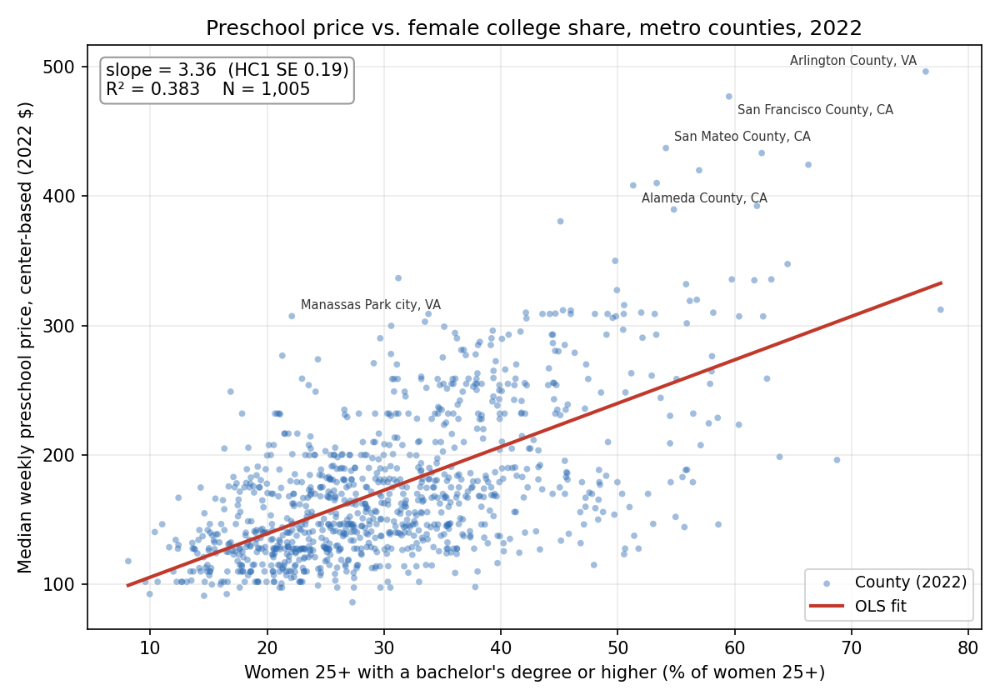

# MGT-403 Data Project — Pre-Analysis Project Data Work: Prices and Costs

*Generated by `code/pre_analysis.py`. Every number in this document is written by the script from its own output; re-running the script regenerates this file, all tables, and all figures.*

**Sample:** U.S. counties in OEWS **metropolitan** areas (OEWS area code beginning `00`), excluding Puerto Rico. **Price** = NDCP `MCPRESCHOOL`, the median weekly full-time price of center-based care for preschoolers (36–54 months). **Dollar values** are in constant 2022 dollars (CPI-U).

---

## 1. Analysis dataset

The NDCP county prices (2015–2022) were merged onto the Problem Set 5 year × county metro panel (OEWS childcare-worker wages + ACS variables) on **[year, county FIPS]**, with FIPS as a 5-character zero-padded string and year as an integer in both files.

| | Rows |
|---|---:|
| NDCP, 2015–2022 | 25,763 (3,222 counties) |
| PS5 metro panel | 9,873 (1,236 counties) |
| Matched | 9,873 |
| PS5 rows not found in NDCP | 0 |
| NDCP rows not found in PS5 | 15,890 |

Every PS5 county-year found a match in NDCP. The unmatched NDCP rows break down as: 15,890 nonmetro OEWS area (outside metro sample). These are excluded by design, because the analysis is restricted to metropolitan counties. Examples: Barbour County, AL (01005, 2015: Southeast Alabama nonmetropolitan area, area 0100004); Bullock County, AL (01011, 2015: Southeast Alabama nonmetropolitan area, area 0100004); Butler County, AL (01013, 2015: Southeast Alabama nonmetropolitan area, area 0100004); Chambers County, AL (01017, 2015: Northeast Alabama nonmetropolitan area, area 0100002).

The **analysis dataset** is every year × county row where the preschool price **and** all ten predictors (childcare-worker mean annual wage, per-capita income, total population, children under 6, children under 6 with all parents in the labor force, median gross rent, female college share, female full-time-year-round share, under-6 share, under-6 care-need share) are non-missing. Rows dropped at each step (year columns = rows dropped in that year):

| Step | Dropped | Rows left | 2015 | 2016 | 2017 | 2018 | 2019 | 2020 | 2021 | 2022 |
|---|---|---|---|---|---|---|---|---|---|---|
| merged PS5 metro panel | 0 | 9,873 | 0 | 0 | 0 | 0 | 0 | 0 | 0 | 0 |
| drop Puerto Rico (state FIPS 72) | 552 | 9,321 | 69 | 69 | 69 | 69 | 69 | 69 | 69 | 69 |
| drop missing preschool price | 1,179 | 8,142 | 161 | 139 | 102 | 101 | 103 | 103 | 317 | 153 |
| drop missing childcare_wage_a_mean | 50 | 8,092 | 8 | 6 | 6 | 1 | 2 | 13 | 7 | 7 |
| drop missing per_capita_income | 0 | 8,092 | 0 | 0 | 0 | 0 | 0 | 0 | 0 | 0 |
| drop missing pop_total | 0 | 8,092 | 0 | 0 | 0 | 0 | 0 | 0 | 0 | 0 |
| drop missing kids_under6 | 0 | 8,092 | 0 | 0 | 0 | 0 | 0 | 0 | 0 | 0 |
| drop missing kids_under6_allpar_lf | 0 | 8,092 | 0 | 0 | 0 | 0 | 0 | 0 | 0 | 0 |
| drop missing median_gross_rent | 3 | 8,089 | 1 | 0 | 0 | 0 | 0 | 0 | 1 | 1 |
| drop missing female_college_share | 0 | 8,089 | 0 | 0 | 0 | 0 | 0 | 0 | 0 | 0 |
| drop missing female_ftyr_share | 0 | 8,089 | 0 | 0 | 0 | 0 | 0 | 0 | 0 | 0 |
| drop missing under6_share | 0 | 8,089 | 0 | 0 | 0 | 0 | 0 | 0 | 0 | 0 |
| drop missing under6_careneed_share | 0 | 8,089 | 0 | 0 | 0 | 0 | 0 | 0 | 0 | 0 |

Result: **8,089 county-years** covering **1,095 distinct counties**.

| Year | Counties | States | OEWS metro areas |
|---|---|---|---|
| 2015 | 994 | 43 | 335 |
| 2016 | 1,019 | 44 | 343 |
| 2017 | 1,057 | 46 | 351 |
| 2018 | 1,062 | 46 | 353 |
| 2019 | 1,061 | 46 | 353 |
| 2020 | 1,050 | 46 | 344 |
| 2021 | 841 | 41 | 284 |
| 2022 | 1,005 | 45 | 334 |

Missing prices cluster by state and year rather than being scattered across counties: 990 of the 1,179 missing-price county-years (84%) are state-years where NDCP has no metro-county price at all; states with no price in any year: IN, NM. Below are the states with at least 20 missing-price county-years (counts are metro county-years with no NDCP price; Puerto Rico excluded):

| State | 2015 | 2016 | 2017 | 2018 | 2019 | 2020 | 2021 | 2022 | Total |
|---|---|---|---|---|---|---|---|---|---|
| IN | 44 | 44 | 44 | 44 | 44 | 44 | 44 | 44 | 352 |
| MO | 27 | 22 | 27 | 26 | 27 | 27 | 34 | 34 | 224 |
| CO | 0 | 17 | 17 | 17 | 17 | 17 | 17 | 0 | 102 |
| VA | 0 | 0 | 0 | 0 | 0 | 0 | 80 | 0 | 80 |
| NY | 38 | 38 | 0 | 0 | 0 | 0 | 0 | 0 | 76 |
| PA | 0 | 0 | 0 | 0 | 0 | 0 | 37 | 37 | 74 |
| NM | 7 | 7 | 7 | 7 | 7 | 7 | 7 | 7 | 56 |
| NC | 0 | 0 | 0 | 0 | 0 | 0 | 46 | 0 | 46 |
| CA | 0 | 0 | 0 | 0 | 0 | 0 | 37 | 0 | 37 |
| AR | 0 | 0 | 0 | 0 | 1 | 1 | 1 | 20 | 23 |
| IA | 21 | 0 | 0 | 0 | 0 | 0 | 0 | 0 | 21 |
| NV | 0 | 0 | 4 | 4 | 4 | 4 | 4 | 0 | 20 |

The large 2021 gap is why 2021 has the fewest counties. Missing wages (50 rows) reflect BLS suppression of individual area-years; missing rent (3 rows) reflects ACS suppression. No other predictor had missing values.

---

## 2. Summary statistics, 2022 analysis dataset

N = 1,005 metro counties. SD is the sample standard deviation. Dollar values are 2022 dollars (2022 is the base year, so 2022 values equal nominal values, except Connecticut's carried-forward rent and income; see Data handling).

| Variable | Units | Mean | SD | N | Min | Max |
|---|---|---:|---:|---:|---:|---:|
| Median weekly price, center-based preschool | weekly $, 2022 $ | 175.09 | 60.03 | 1,005 | 86.19 | 496.30 |
| Childcare-worker mean annual wage (OEWS 39-9011) | annual $, 2022 $ | 27,816 | 4,358 | 1,005 | 19,540 | 41,700 |
| Median gross rent (rent + utilities) | monthly $, 2022 $ | 1,108 | 336 | 1,005 | 430 | 2,805 |
| Per-capita income | annual $, 2022 $ | 37,934 | 9,492 | 1,005 | 16,368 | 89,702 |
| Total population | persons | 257,424 | 550,374 | 1,005 | 50 | 9,936,690 |
| Own children under 6 | children | 17,234 | 37,184 | 1,005 | 0 | 616,046 |
| Children under 6, all resident parents in labor force | children | 11,605 | 24,506 | 1,005 | 0 | 406,465 |
| Share of women 25+ with bachelor's degree or higher | proportion (0-1) | 0.307 | 0.111 | 1,005 | 0.081 | 0.776 |
| Share of women 16-64 working full-time, year-round | proportion (0-1) | 0.446 | 0.056 | 1,005 | 0.212 | 0.714 |
| Children under 6 / total population | proportion (0-1) | 0.064 | 0.011 | 1,005 | 0.000 | 0.109 |
| Children under 6 w/ all parents in LF / total population | proportion (0-1) | 0.043 | 0.009 | 1,005 | 0.000 | 0.070 |

*Table file: `output/tables/summary_2022.csv`.* Note that the minimum population (50) is Kalawao County, HI, a very small county that sits inside the Kahului-Wailuku-Lahaina, HI metro area; it meets the sample definition and is kept.

The typical metro county charges **$175.09/week** for center-based preschool (SD $60.03), or about $9,104 per year at 52 weeks. Childcare workers earn on average **$27,816** per year (SD $4,358). Median gross rent averages **$1,108/month** (SD $336). Prices vary a lot: the most expensive county charges 5.8× the cheapest ($496.30 vs. $86.19).

---

## 3. Scatter plots, 2022

In both plots the line is the OLS fit. Slopes use wages in **$1,000s per year** and rent in **$100s per month**. SEs are heteroskedasticity-robust (HC1). The five largest absolute residuals are labeled.

**(a) Price vs. childcare-worker wage.** The relationship is **positive and strong**. Each $1,000 of higher annual childcare wage goes with **$10.21 higher weekly price** (HC1 SE 0.40), or about $531 per child per year. A one-SD difference in wages ($4,358) corresponds to roughly **$44/week**. Wages alone explain **54.9%** of the cross-county variation in price (R² = 0.549).

- **Wage varies by metro area, not by county.** The 2022 sample has only 294 distinct wage values for 1,005 counties, so the points form vertical stripes. Every county in a metro area shares one wage but can have a very different price.
- **Outliers.** The largest outliers are counties priced far **above** the line: Arlington County, VA (Washington-Arlington-Alexandria, DC-VA-MD-WV): $496.30/wk, +$243 vs. fitted; San Francisco County, CA (San Francisco-Oakland-Hayward, CA): $477.04/wk, +$175 vs. fitted; Alexandria city, VA (Washington-Arlington-Alexandria, DC-VA-MD-WV): $424.29/wk, +$171 vs. fitted; Stearns County, MN (St. Cloud, MN): $336.67/wk, +$162 vs. fitted; District of Columbia, DC (Washington-Arlington-Alexandria, DC-VA-MD-WV): $392.50/wk, +$139 vs. fitted. The most under-priced counties relative to the line are San Bernardino County, CA (Riverside-San Bernardino-Ontario, CA): $173.00/wk, −$125 vs. fitted; Warren County, VA (Washington-Arlington-Alexandria, DC-VA-MD-WV): $128.87/wk, −$125 vs. fitted; Riverside County, CA (Riverside-San Bernardino-Ontario, CA): $188.73/wk, −$109 vs. fitted.
- **The residuals are right-skewed.** The 99th-percentile residual is +$123; the 1st percentile is −$89.
- **Heteroskedasticity.** The scatter fans out as wages rise. A Breusch–Pagan test rejects constant variance (LM = 106.5, p < 0.001). The robust SE on the slope is 1.38× the classical SE.

**(b) Price vs. median gross rent.** The relationship is also **positive and strong**. Each $100/month of higher median rent goes with **$12.14 higher weekly price** (HC1 SE 0.53). A one-SD difference in rent ($336/month) corresponds to roughly **$41/week**. Rent alone explains **46.2%** of the variation (R² = 0.462), less than wages do.

- **Outliers.** The largest positive outliers are Arlington County, VA (Washington-Arlington-Alexandria, DC-VA-MD-WV): $496.30/wk, +$185 vs. fitted; Stearns County, MN (St. Cloud, MN): $336.67/wk, +$178 vs. fitted; San Francisco County, CA (San Francisco-Oakland-Hayward, CA): $477.04/wk, +$155 vs. fitted; Norfolk County, MA (Boston-Cambridge-Nashua, MA-NH): $420.00/wk, +$145 vs. fitted; Alexandria city, VA (Washington-Arlington-Alexandria, DC-VA-MD-WV): $424.29/wk, +$143 vs. fitted. The most under-priced counties relative to the line are Williamson County, TN (Nashville-Davidson--Murfreesboro--Franklin, TN): $146.35/wk, −$115 vs. fitted; Chatham County, GA (Savannah, GA): $98.00/wk, −$98 vs. fitted; Prince George County, VA (Richmond, VA): $128.87/wk, −$96 vs. fitted.
- **The residuals are right-skewed.** The 99th-percentile residual is +$111; the 1st percentile is −$82.
- **Heteroskedasticity.** The spread widens at high rents (Breusch–Pagan LM = 96.7, p < 0.001). The robust SE is 1.28× the classical SE.

**Interpretation.** Higher-cost markets charge more, which fits the idea that prices partly reflect labor and space costs. These are associations, not causal effects. High-wage and high-rent counties are also richer, more educated, and denser, so they likely have stronger demand. A wage effect of $531 per child per year for each $1,000 of annual wage per worker looks larger than a pure cost pass-through would produce, since each worker cares for several children. So the wage slope probably also picks up demand and local affluence.

For the location question, the counties far above the line (Arlington and Alexandria, VA, and St. Cloud, MN, for example) are early candidates for "prices high relative to costs." Because wages are measured at the metro level, residuals within one metro area mostly reflect county-level price differences.

---

## 4. Regressions, 2022

**Dependent variable:** median weekly preschool price (2022 $). **Wage** is in **$1,000s per year** and **rent** is in **$100s per month**, both in 2022 dollars. **Female college share** (`female_college_share` = women 25+ with a bachelor's degree or higher ÷ all women 25+, ACS) is in **percentage points**. Models (d) and (e) add this demand-side variable, chosen because it had the highest stand-alone R² of the non-cost variables in the predictor screen below, to the three cost models the assignment asks for. SEs are heteroskedasticity-robust **HC1** (White, with the n/(n−k) small-sample correction). p-values use the t distribution with n − k degrees of freedom.

| | (a) Wage only | (b) Rent only | (c) Wage + rent | (d) College share only | (e) Wage + rent + college share |
|---|---:|---:|---:|---:|---:|
| Intercept | **-108.935** | **40.658** | **-89.403** | **71.995** | **-100.029** |
| &nbsp;&nbsp;robust SE (HC1) | (10.629) | (5.525) | (8.666) | (5.147) | (7.933) |
| &nbsp;&nbsp;t-stat | t = -10.25 | t = 7.36 | t = -10.32 | t = 13.99 | t = -12.61 |
| &nbsp;&nbsp;p-value | p < 0.001 | p < 0.001 | p < 0.001 | p < 0.001 | p < 0.001 |
| Childcare wage ($1,000s/yr, 2022 $) | **10.211** |  | **7.148** |  | **7.230** |
| &nbsp;&nbsp;robust SE (HC1) | (0.403) |  | (0.360) |  | (0.329) |
| &nbsp;&nbsp;t-stat | t = 25.34 |  | t = 19.83 |  | t = 21.95 |
| &nbsp;&nbsp;p-value | p < 0.001 |  | p < 0.001 |  | p < 0.001 |
| Median gross rent ($100s/mo, 2022 $) |  | **12.137** | **5.929** |  | **2.186** |
| &nbsp;&nbsp;robust SE (HC1) |  | (0.531) | (0.548) |  | (0.612) |
| &nbsp;&nbsp;t-stat |  | t = 22.85 | t = 10.82 |  | t = 3.57 |
| &nbsp;&nbsp;p-value |  | p < 0.001 | p < 0.001 |  | p < 0.001 |
| Female college share (pct. points) |  |  |  | **3.360** | **1.623** |
| &nbsp;&nbsp;robust SE (HC1) |  |  |  | (0.187) | (0.168) |
| &nbsp;&nbsp;t-stat |  |  |  | t = 17.99 | t = 9.64 |
| &nbsp;&nbsp;p-value |  |  |  | p < 0.001 | p < 0.001 |
| N | 1,005 | 1,005 | 1,005 | 1,005 | 1,005 |
| R² | 0.549 | 0.462 | 0.610 | 0.383 | 0.657 |
| Adjusted R² | 0.549 | 0.461 | 0.609 | 0.383 | 0.656 |

*Table files: `output/tables/regressions_2022.csv` and `.md`.*

**Correlation between childcare wage and median gross rent (2022):** r = **0.670**.

**(a) Wage only.** A $1,000 higher annual childcare-worker wage is associated with a **$10.21** higher weekly preschool price (t = 25.3, p < 0.001). The intercept (-108.9) is the extrapolated price at a $0 wage. It has no economic meaning because the lowest observed wage is $19,540.

**(b) Rent only.** A $100/month higher median gross rent is associated with a **$12.14** higher weekly price (t = 22.9, p < 0.001).

**(c) Wage and rent together.**

- **Wage, holding rent constant:** a $1,000 higher annual childcare wage is associated with a **$7.15** higher weekly price (t = 19.8).
- **Rent, holding wage constant:** a $100/month higher median rent is associated with a **$5.93** higher weekly price (t = 10.8).
- **Fit:** both remain highly significant (p < 0.001), and R² rises to **0.610** from 0.549 (wage only) and 0.462 (rent only).
- **Equal-SD comparison:** a one-SD increase in wage goes with $31/week and a one-SD increase in rent with $20/week, so wages are the stronger of the two cost signals.

**Why the coefficients change: omitted variable bias.** Each univariate model leaves out the other cost variable. The coefficient on the included variable therefore also picks up part of the omitted variable's effect:

  short coefficient = long coefficient + (omitted variable's long coefficient) × (slope of omitted on included)

- **Sign of the bias:** wages and rent are **positively correlated** (r = 0.670), and each has a **positive** effect in model (c). Both univariate coefficients should therefore be biased **upward**, and both should fall when the other variable is added.
- **Wage coefficient:** regressing rent ($100s) on wage ($1,000s) gives a slope of 0.517. The predicted bias is 5.929 × 0.517 = **+3.063**. Indeed, 10.211 (a) = 7.148 (c) + 3.063. The wage coefficient falls by 30%.
- **Rent coefficient:** regressing wage on rent gives a slope of 0.869. The predicted bias is 7.148 × 0.869 = **+6.209**. Indeed, 12.137 (b) = 5.929 (c) + 6.209. The rent coefficient falls by 51%.
- **Check:** the observed direction of change matches the OVB prediction for both coefficients (both fall). The script verifies the decomposition holds exactly in the data.

The rent coefficient shrinks by more than the wage coefficient. A large part of the rent-only slope reflects the fact that high-rent counties are also high-wage counties, while wages keep most of their association with price after controlling for rent.

**(d) Female college share, alone.** A county where the share of women 25+ with a bachelor's degree is one percentage point higher has a **$3.36** higher weekly preschool price on average (HC1 SE 0.19, t = 17.99, p < 0.001). College share alone explains **38.3%** of the variation in price (R² = 0.383). That is less than wage (0.549) or rent (0.462) alone, but far more than the population and child measures tried earlier.

- **Size of a typical difference:** the share averages 30.7% (SD 11.1 points). A one-SD difference goes with about **$37/week**. Moving from the 10th percentile (18.0%) to the 90th (45.6%) implies $93/week more.
- **What the plot shows:** a clear upward slope. The spread widens at higher college shares, the same fan shape seen in the wage and rent plots.

**(e) Wage, rent and female college share together.**

- **College share:** **$1.62** per percentage point, holding wage and rent constant (HC1 SE 0.17, t = 9.64, p < 0.001). About half its stand-alone size, but still highly significant.
- **Wage:** **$7.23** per $1,000, holding rent and college share constant (t = 21.9). Slightly **up** from $7.15 in model (c).
- **Rent:** **$2.19** per $100/month, holding wage and college share constant (t = 3.6, p < 0.001). **Down sharply** from $5.93 in model (c), a 63% drop.
- **Fit:** R² rises from 0.610 to **0.657**. College share adds explanatory power beyond the two cost variables.

**Why the college coefficient falls from (d) to (e) (OVB).** College share is positively correlated with wages (r = 0.449) and especially with rent (r = 0.687). Model (d) therefore credits college share with part of the cost effects:

  3.360 (d) = 1.623 (e) + 7.230 × 0.1771 (via wage) + 2.186 × 0.2089 (via rent) = 1.623 + 1.280 + 0.457

Here 0.1771 and 0.2089 are the slopes from regressing wage ($1,000s) and rent ($100s) on college share (percentage points). Both terms are positive, so the stand-alone coefficient is biased **upward**. It falls when wage and rent are added, as OVB predicts.

**Why the rent coefficient falls from (c) to (e) (OVB the other way round).** Model (c) omitted college share, which raises price and is correlated with rent. Regressing college share on wage and rent together gives:

- **Rent:** a coefficient of 2.306 percentage points per $100 of rent, holding wage fixed. Positive.
- **Wage:** a coefficient of -0.051 points per $1,000 of wage, holding rent fixed. Slightly negative. Among counties with the same rent, higher-wage ones have marginally *lower* college shares.

The omitted-variable bias in model (c) is therefore:

- **Rent coefficient:** 1.623 × 2.306 = **+3.742**, so 5.929 (c) = 2.186 (e) + 3.742. Biased upward, and it falls when college share is added.
- **Wage coefficient:** 1.623 × (-0.051) = **-0.082**, so 7.148 (c) = 7.230 (e) + (-0.082). Biased slightly downward, and it rises a little when college share is added.

Both observed changes match the direction OVB predicts, and the script verifies all three decompositions hold exactly.

**What this means.** Much of what looked like a "rent effect" in model (c) was really an affluence and education effect: high-rent counties are places with many college-educated women, and those places pay more for preschool. Once that is controlled for, childcare wages are the dominant cost signal and rent matters much less. College share is a demand-side variable, so its coefficient reflects both willingness to pay and the kind of care these markets buy. It is an association, not a causal effect.

### Predictor screen: which summary-table variables explain price best? (2022)

Each variable in the summary table was regressed on its own against the 2022 weekly preschool price (N = 1,005). Each non-cost variable was also added to the wage + rent model (c), which has R² = 0.610. The table is sorted by the stand-alone R². The **ΔR²** column shows how much a variable adds **beyond** wages and rent.

| Rank | Variable | Coef. unit | Alone: coef (HC1 SE) | Alone: p | **Alone: R²** | With wage + rent: coef (HC1 SE) | p | R² | **ΔR² vs. wage + rent** |
|---:|---|---|---:|---:|---:|---:|---:|---:|---:|
| 1 | Childcare-worker mean annual wage | per $1,000/yr | 10.211 (0.403) | < 0.001 | **0.549** | — | — | — | — |
| 2 | Per-capita income | per $1,000/yr | 4.515 (0.195) | < 0.001 | **0.510** | 2.365 (0.240) | < 0.001 | 0.667 | **+0.057** |
| 3 | Median gross rent | per $100/mo | 12.137 (0.531) | < 0.001 | **0.462** | — | — | — | — |
| 4 | Share of women 25+ with bachelor's+ | per pct. point | 3.360 (0.187) | < 0.001 | **0.383** | 1.623 (0.168) | < 0.001 | 0.657 | **+0.047** |
| 5 | Children <6, all parents in labor force | per 1,000 children | 0.751 (0.198) | < 0.001 | **0.094** | 0.009 (0.065) | 0.890 | 0.610 | **+0.000** |
| 6 | Total population | per 100,000 people | 3.333 (0.987) | < 0.001 | **0.093** | -0.042 (0.280) | 0.880 | 0.610 | **+0.000** |
| 7 | Own children under 6 | per 1,000 children | 0.464 (0.123) | < 0.001 | **0.083** | -0.015 (0.039) | 0.701 | 0.610 | **+0.000** |
| 8 | Share of women 16-64 full-time year-round | per pct. point | 2.053 (0.360) | < 0.001 | **0.036** | 0.819 (0.230) | < 0.001 | 0.616 | **+0.005** |
| 9 | Children <6 w/ all parents in LF / population | per pct. point | 6.722 (1.924) | < 0.001 | **0.010** | 3.732 (1.262) | 0.003 | 0.613 | **+0.003** |
| 10 | Children under 6 / population | per pct. point | -1.672 (1.493) | 0.263 | **0.001** | -1.189 (0.969) | 0.220 | 0.611 | **+0.001** |

*Table file: `output/tables/predictor_screen_2022.csv`.* Scaling changes the coefficients but not R².

**Highest stand-alone R².** The top four are:

1. childcare wage (0.549)
2. per-capita income (0.510)
3. median rent (0.462)
4. female college share (0.383)

Everything else explains under 10% of the variation on its own.

**Best additions to wage + rent.**

- **Per-capita income:** R² rises from 0.610 to **0.667** (ΔR² = +0.057). Coefficient: $2.36/week per $1,000 of income, p < 0.001.
- **Female college share:** R² rises to **0.657** (ΔR² = +0.047). Coefficient: $1.62/week per percentage point, p < 0.001.
- **The rest:** every other variable adds less than 0.01 to R². That includes the population and child measures tried earlier. Female college share is the variable used in models (d) and (e) above.

**What this means:** prices are explained by local costs plus how affluent and educated a county is, not by how many people or young children it has. These are associations, not causal effects. Income and college share are also correlated with each other and with wages and rent, so their coefficients would change if both were added together.

Both coefficients in model (c) may still be biased by omitted demand variables, such as income and education, that are correlated with both costs and prices.

Wage is measured at the metro level, so counties in the same metro area are not independent observations. Standard errors clustered by metro area would be a natural robustness check. HC1 does not account for this.

---

## Data handling decisions

1. **Sources.**
   - **Prices:** U.S. DOL National Database of Childcare Prices, county workbook `NDCP2022.xlsx`, sheet `County_LevelNDCP_v8_update2008_`.
   - **Wages and ACS variables:** the Problem Set 5 panel `ps5_county_panel_2015_2022.csv`. It contains OEWS SOC 39-9011 mean annual wage by metro area, merged down to counties with the course crosswalk `county_oews_crosswalk.csv`, plus ACS 5-year county variables.
2. **Price variable.** `MCPRESCHOOL`: the median weekly full-time price of **center-based** care for **preschool** age (36–54 months). The NDCP data dictionary calls it "MCPreschool"; the column in the workbook is `MCPRESCHOOL`. `MCPreschool_flag` describes how the age-band price was aggregated (1 = all bands equal, 2 = mode, 3 = highest mode). It is kept for reference and is **not** used to exclude rows.
3. **Years.** 2015–2022 (`STUDYYEAR` in NDCP; `year` in PS5), stored as integers in both files.
4. **Merge keys and FIPS padding.**
   - The merge is on `[year, county_fips]`, one-to-one (validated).
   - NDCP stores FIPS as a number (e.g., `1001`). It was read as text and zero-padded to 5 characters (`01001`). PS5 FIPS were also read as text and padded.
   - OEWS area codes are kept as 7-character text.
   - The output CSV stores FIPS as text, and the script asserts every code is 5 digits on re-read.
5. **Metro sample.** Counties whose year-specific OEWS area code starts with `00`, inherited from PS5. Nonmetro NDCP counties (15,890 county-years) are therefore not matched.
6. **Puerto Rico dropped** (552 county-years). NDCP has PR prices only for 2021. For 5 PR municipios (72003, 72005, 72007, 72009, 72131), the NDCP FIPS code carries a different municipio's name than Census/ACS, so the price-to-county mapping is unreliable. No name mismatches were found outside Puerto Rico.
7. **ACS vintage.** NDCP/OEWS year *t* is matched to the ACS **5-year vintage ending in year *t*** (for example, 2022 ↔ ACS 2018–2022), as in PS5.
8. **Inflation adjustment.**
   - All dollar variables (price, wage, rent, per-capita income) are converted to **constant 2022 dollars** with the CPI-U, U.S. city average, all items (BLS series CUUR0000SA0), annual averages: 2015 237.017, 2016 240.007, 2017 245.120, 2018 251.107, 2019 255.657, 2020 258.811, 2021 270.970, 2022 292.655.
   - Real value = nominal × CPI₂₀₂₂ / CPI_t.
   - For prices and wages, *t* is the data year.
   - For ACS rent and income, *t* is the **ACS vintage year**, because ACS 5-year dollars are expressed in the vintage's final-year dollars.
   - Source: BLS, Historical CPI-U table (https://www.bls.gov/cpi/tables/supplemental-files/historical-cpi-u-202212.pdf).
9. **Connecticut 2022.** The 2022 ACS reports Connecticut by planning region rather than county. PS5 therefore carries forward 2021-vintage ACS values for the legacy counties (flag `acs_ct_2021_carryforward`). These 7 rows are kept, and their rent and income are deflated with the **2021** CPI, consistent with the vintage rule above.
10. **Missing data.** Rows are dropped if the price or any of the ten predictors is missing. The drop counts at each step are in Section 1. No values are imputed.
11. **Flagged but kept.**
    - DeKalb County, Missouri in 2018 has a price of $37.87/week (nominal). It is the only analysis county-year under $50 (flag `flag_low_price_outlier`).
    - 299 county-years have 2015–2017 wages rebuilt in PS5 as employment-weighted averages of OEWS Metropolitan Division means (flag `wage_from_divisions`).
12. **Regression conventions.** Wages are in $1,000s per year and rent in $100s per month, both in 2022 $. Female college share is in percentage points. OLS with HC1 robust SEs and t-distribution p-values. The OLS/HC1 routine is hand-coded in numpy. It is checked against closed-form univariate formulas, and against statsmodels when that package is installed.

## Files

- `data/processed/analysis_dataset.csv`: analysis dataset, all years, with nominal and 2022-$ columns.
- `output/tables/summary_2022.csv` and `summary_2022.md`: Q2 summary table.
- `output/tables/regressions_2022.csv` and `regressions_2022.md`: Q4 regression table.
- `output/tables/predictor_screen_2022.csv` and `predictor_screen_2022.md`: one-at-a-time R² screen of all summary-table variables.
- `output/figures/scatter_price_vs_wage_2022.png` and `scatter_price_vs_rent_2022.png`: Q3 scatter plots.
- `output/figures/scatter_price_vs_female_college_share_2022.png`: price vs. female college share (model d).
- `output/pre_analysis_log.txt`: full console log of the run.
